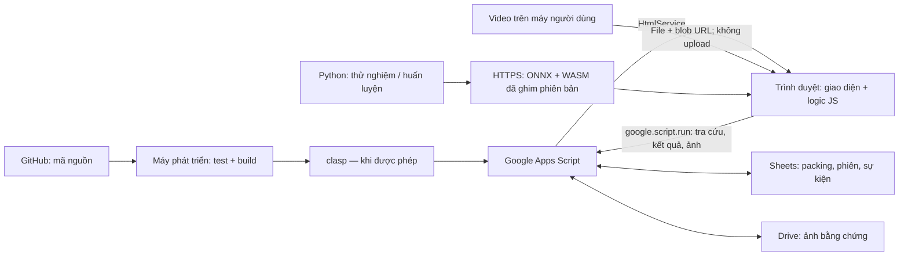
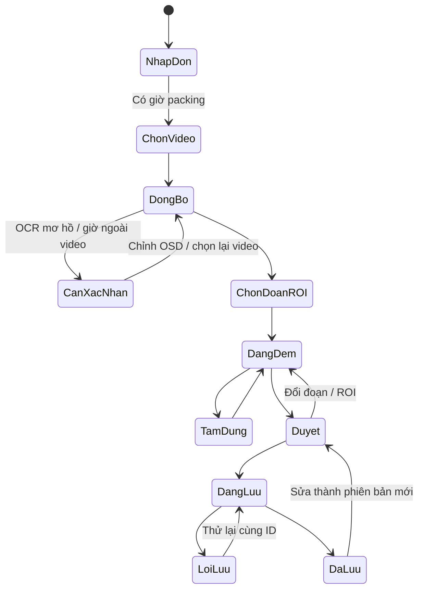

# Phương án: xử lý video trong trình duyệt, webapp GAS cho cả nhóm

> Bản phương án do Codex soạn (chỉ đọc repo), Claude review ngày 2026-11-08. Quyết định cuối cùng ở cuối file.

**Đề xuất: một webapp GAS, toàn bộ video/OCR/AI chạy trong trình duyệt; GAS chỉ xác thực, tra packing và lưu kết quả/ảnh.** Cần vượt qua thử nghiệm iframe, giải mã video và hiệu năng trước khi xây đầy đủ.

Đã đọc đủ 7 file yêu cầu, không đọc `Images.html`, không tạo/sửa file hay commit. Đây là phương án thiết kế; chưa kiểm chứng trên webapp triển khai.

## 1. Kiến trúc

Trong trình duyệt: **đọc video → OCR OSD → ánh xạ giờ → chọn đoạn → detector + tracking + đếm → người dùng duyệt**.

Hiện trạng cần chuyển đổi:

- `Index.html` mới có tra cứu/xem ảnh; đã chống phản hồi bất đồng bộ cũ, nên giữ nguyên nguyên tắc này.
- `Code.js` có `uiPackingTime`, nhưng ghi kết quả/ảnh chỉ qua `doPost` dùng `API_TOKEN`. Cần bổ sung RPC ghi cho trình duyệt; **không đưa `API_TOKEN` vào JS phía khách**.
- `clock.py`/`sync.py` là tham chiếu thuật toán: phân biệt ngày/tháng bằng thứ, loại OCR lệch đơn lẻ, tách đoạn đồng hồ nhảy, căn theo thời điểm đổi giây.
- README và tài liệu kiến trúc còn mô tả đường chạy Python; Claude cập nhật sau khi chốt phương án.

## 2. Luồng người dùng và trạng thái phiên

1. Mở link, xác thực; bắn mã đơn.
2. Chọn video local. Đồng thời tra giờ packing và kiểm tra khả năng trình duyệt.
3. Đọc OSD tại các mốc; hiển thị ngày, khoảng giờ video, độ tin cậy và cảnh báo.
4. Tua quanh packing. Người dùng xác nhận đúng thời điểm, chọn **đầu/cuối đoạn cần đếm**.
5. Khoanh miệng bao, chọn hướng đi vào; gán camera/bao.
6. AI phân tích đoạn đã chọn, hiển thị tiến độ và các lượt nghi ngờ.
7. Người dùng xem từng lượt, thêm/xóa/tách/gộp, sửa thời điểm.
8. Xem trước ảnh sẽ gửi; lưu kết quả và ảnh. Chỉ báo hoàn tất khi server xác nhận đủ.
9. Thành viên khác tìm mã để xem kết quả đã lưu.

**Không mặc định đoạn quanh packing chứa toàn bộ phiên đóng bao.** Đếm trong đoạn chỉ là tổng tạm; chỉ chốt tổng bao khi xác nhận đủ đầu/cuối phiên.

Đổi video phải vô hiệu hóa đồng bộ/ROI/kết quả phụ thuộc. Hủy tác vụ bỏ kết quả trả về muộn; hủy ở trình duyệt không có nghĩa RPC đang chạy trên GAS đã bị hủy.

## 3. Tổ chức file và quyền sở hữu

**Chọn một bước build nhỏ cho logic JS**, để nguồn thật là module JS kiểm thử được bằng Node. Không viết logic trình duyệt trong `gas/*.js`: các file này là mã server.

| File/nhóm file đề xuất | Nội dung | Sở hữu |
|---|---|---|
| `gas/Code.js` | `doGet`, include template, RPC, xác thực, Sheet/Drive | Claude |
| `browser/core/clock.mjs`, `sync.mjs`, `counter.mjs` | Logic thuần, không DOM/GAS | Claude |
| `browser/video.mjs`, `ocr.mjs`, `inference.mjs` | Giải mã, OCR, ONNX | Claude |
| `browser/controller.mjs`, `server.mjs`, `worker.mjs` | Điều phối phiên, RPC, worker | Claude |
| `scripts/build-browser.mjs`, `tests/browser/*.test.mjs` | Build và kiểm thử logic | Claude |
| `gas/LogicBundle.html` | Artifact sinh tự động chứa JS client | Build; không sửa tay |
| `gas/Index.html` | Khung trang và thứ tự include | Codex |
| `gas/UiStyles.html` | CSS | Codex |
| `gas/UiViews.html` | Markup các màn hình | Codex |
| `gas/UiBindings.html` | DOM, thao tác khoanh vùng, hiển thị sự kiện | Codex |

Đây là **phân quyền đề xuất**; Claude cần cập nhật AGENTS trước khi giao Codex sửa các file UI mới ngoài phạm vi hiện tại.

- Đổi `doGet` sang template có `evaluate()`; include cố định các partial, logic trước UI. Google hướng dẫn tách CSS/JS thành HTML partial theo cách này. [HtmlService best practices](https://developers.google.com/apps-script/guides/html/best-practices)
- Build bundle dạng một namespace `CountingApp`; worker được đóng gói, thử khả năng tạo worker từ blob trong iframe.
- Không cần framework UI hay bước build CSS.
- Node kiểm thử trực tiếp module nguồn: parse ngày/thứ, nhảy giờ, khoảng giờ thiếu/trùng, chống đếm lặp, chuyển trạng thái, retry.
- Test Node không thay thế test iframe thật. Cấu hình build/clasp dùng danh sách file rõ ràng, không đọc hay ghép `Images.html`.

## 4. Hợp đồng giao diện–logic

UI chỉ gọi `CountingApp`; Claude sở hữu toàn bộ thao tác video, OCR, AI và RPC.

Quy ước: `videoTimeS` tính bằng giây; ROI dùng tọa độ chuẩn hóa `[0..1]` trên ảnh gốc, không trên phần viền đen. Giờ thực có múi giờ rõ ràng; không tự parse chuỗi thiếu timezone theo máy người dùng.

| Hàm đề xuất | Tham số chính | Trả về |
|---|---|---|
| `init` | `{videoElement}` | `Promise<Capabilities>`: WebGPU, WASM, WebCodecs, worker |
| `authenticate` | `{credential}` | `Promise<{actor, permissions}>` |
| `lookupOrder` | `{orderCode}` | `Promise<{orderCode, packingTime, timeZone}>` |
| `openVideo` | `{file: File}` | `Promise<{videoId, width, height, durationS}>` |
| `syncClock` | `{videoId, clockRoi, dateOrder?}` | `Promise<{segments, warnings, uncertaintyS}>` |
| `locatePacking` | `{packingTime, beforeS, afterS}` | `{ranges, warnings}`; có thể nhiều đoạn nếu giờ lặp |
| `seek` | `{videoTimeS}` | `Promise<{actualVideoTimeS, wallTime, uncertaintyS}>` |
| `configureSession` | `{orderCode, bagId, camera, range, bagRoi, entryDirection}` | Snapshot phiên đã kiểm tra |
| `startCount` | `{sessionId}` | `Promise<SessionSnapshot>` |
| `pause` / `resume` / `cancel` | `{sessionId}` | `Promise<SessionSnapshot>` |
| `editEvent` | `{sessionId, eventId?, operation, patch}` | Snapshot mới; hỗ trợ thêm/xóa/sửa/tách/gộp |
| `prepareEvidence` | `{sessionId, eventIds, kinds}` | `Promise<EvidencePreview[]>`; blob URL chỉ local |
| `saveSession` | `{sessionId, expectedRevision, closeSession}` | `Promise<{sessionId, revision, status}>` |
| `searchResults` / `getResult` | `{query}` / `{id}` | Danh sách / chi tiết |
| `subscribe` | `listener` | Hàm hủy đăng ký |

Sự kiện gửi UI:

| Tên | Payload |
|---|---|
| `statechange` | `{sessionId, generation, state, allowedActions}` |
| `progress` | `{sessionId, generation, stage, completed, total}` |
| `frame` | `{videoTimeS, wallTime, boxes}` |
| `eventschange` | `{sessionId, revision, events, total}` |
| `warning` / `error` | `{code, message, recoverable, details}` |
| `saveprogress` | `{sessionId, savedImages, totalImages}` |

`generation` ngăn kết quả tác vụ cũ cập nhật phiên mới. `eventId` bất biến, không lấy số thứ tự làm ID.

**RPC GAS Claude cần bổ sung:** lưu bản nháp phiên, upload một ảnh, hoàn tất phiên, đọc phiên. Mọi RPC kiểm tra quyền phía server, revision và khóa idempotency. Dùng JSON/plain object qua RPC; `File`, blob và đối tượng DOM giữ ở browser. `google.script.run` bất đồng bộ và giới hạn kiểu dữ liệu truyền. [Tài liệu RPC](https://developers.google.com/apps-script/guides/html/communication)

Nên thêm Sheet `PhienDem` làm nguồn tổng/trạng thái/revision; `KetQua` tiếp tục lưu sự kiện. Hiện `uploadEvidence_` xóa ảnh cũ trước khi tạo ảnh mới: cần đổi sang **tạo mới → ghi tham chiếu → dọn ảnh cũ**, để lỗi upload không làm mất bằng chứng.

## 5. Spike ưu tiên theo rủi ro

Các ngưỡng dưới đây là **tiêu chí nghiệm thu đề xuất**, chưa phải kết quả đo.

| Ưu tiên | Cách kiểm chứng | Đạt / không đạt |
|---|---|---|
| **1. Video local và đúng khung trong GAS iframe** | Trên URL triển khai thử: mở MP4 270 MB bằng input + `URL.createObjectURL`; đọc canvas; tua 100 vị trí gồm gần đầu/cuối và ngoài keyframe; đối chiếu PTS/khung bằng Python. Thử mở–đóng liên tiếp 10 lần. | Không có request chứa video; canvas đọc được; sai lệch ≤1 khung 40 ms; bộ nhớ không tăng liên tục. Không đạt độ chính xác thì đổi bộ giải mã trước khi làm đếm. |
| **2. WebCodecs và `requestVideoFrameCallback`** | Dùng rVFC lấy `mediaTime` cho preview/OCR; so sánh với demux MP4 + `VideoDecoder` giải mã tuần tự theo timestamp từ keyframe. Kiểm tra H.264 profile thực tế, thứ tự frame, worker. | Đường phân tích không âm thầm bỏ/lặp frame. WebCodecs phải có demuxer; không truyền cả MP4 trực tiếp cho decoder. Nếu thiếu WebCodecs, đường `<video>` phải vượt cùng bài kiểm tra hoặc chỉ hỗ trợ duyệt thủ công. |
| **3. Nhìn thấy và phân biệt được lượt bỏ kiện** | Gán nhãn ≥200 lượt trên ≥10 đoạn khác nhau, gồm che khuất, hai người, hai kiện cùng lúc, tay rút ra. Thử detector nhỏ + tracking + chuyển động qua vùng có hướng. | Trên tập chưa dùng chỉnh mô hình: precision/recall sự kiện ≥95%, ≥90% đoạn đúng tổng. Không đạt thì huấn luyện thêm hoặc giới hạn AI ở gợi ý; không mặc định vật biến mất là đã vào bao. |
| **4. WebGPU/WASM trên máy nhóm** | Trong iframe `googleusercontent`: kiểm tra secure context, `requestAdapter`, tạo session ONNX và chạy mô hình thật. Ép fallback WASM; thử mất GPU, đổi tab. | Đoạn 120 giây xử lý ≤120 giây GPU, ≤360 giây WASM trên máy yếu đại diện; UI hủy/tạm dừng được. Không đạt thì thu nhỏ mô hình/ROI hoặc thu hẹp thiết bị hỗ trợ. |
| **5. OCR OSD và đồng bộ giờ** | 300 crop OSD ở cả 480p/720p, nền sáng/tối; so template matching, Tesseract.js, recognizer PaddleOCR ONNX. Đối chiếu 100 mốc thời gian; thử qua nửa đêm, nhảy giờ, giờ lặp. | ≥99% mẫu được tự chấp nhận đúng; mẫu không chắc phải cảnh báo. Định vị ≤1 giây; chỉ báo ≤40 ms khi thực sự xác minh tick. Không suy diễn qua khoảng mất hình/giờ trùng. |
| **6. Tải mô hình khi repo private** | Tải ONNX/WASM từ endpoint HTTPS có CORS ngay trong iframe, thử cache lạnh/ấm, lỗi mạng, hash/version; thử đúng file kích thước dự kiến. | 20/20 lượt tải đúng hash, không token GitHub ở client; tải lạnh mục tiêu ≤30 giây tại kho. Không đạt nguồn nào thì loại nguồn đó. |
| **7. Ảnh qua `google.script.run`** | Gửi JPEG 100 KB, 300 KB, 1 MB, 3 MB từng ảnh; thử mất mạng sau server ghi, retry, hai người sửa cùng phiên. | 50 ảnh liên tiếp lưu/đọc đúng; retry không thêm bản ghi/ảnh trùng; lỗi không mất ảnh cũ; chưa đủ ảnh không chuyển “đã lưu”. |
| **8. Giấy phép** | Kiểm tra riêng runtime, mã mô hình, weights, dữ liệu huấn luyện và quyền phân phối artifact. | Có nguồn và giấy phép rõ cho từng thành phần; loại weights không rõ điều kiện hoặc AGPL không phù hợp yêu cầu. |

Các lựa chọn cần giữ rõ:

- HtmlService có sandbox iframe; tài liệu không chứng minh toàn bộ pipeline video/AI sẽ chạy được. Phải thử trên bản triển khai thật. [Giới hạn HtmlService](https://developers.google.com/apps-script/guides/html/restrictions)
- rVFC là cơ chế best-effort, không bảo đảm lấy mọi frame. Dùng WebCodecs khi cần kiểm soát giải mã chính xác. [Giải thích của Chrome](https://web.dev/articles/requestvideoframecallback-rvfc)
- Không giả định HTTPS đồng nghĩa có GPU dùng được. Nếu `crossOriginIsolated` không có, đặt WASM một luồng; kiểm tra worker riêng. [WebGPU troubleshooting](https://developer.chrome.com/docs/web-platform/webgpu/troubleshooting-tips), [ONNX deployment](https://onnxruntime.ai/docs/tutorials/web/deploy.html)
- **OCR nhẹ ưu tiên:** crop OSD cố định, chuẩn hóa kích thước/độ tương phản, template chữ số theo camera. Vài khung chưa chắc đủ 0–9; bootstrap bằng OCR tổng quát hoặc người xác nhận. Đọc ngày/thứ ban đầu và kiểm tra định kỳ; không chạy OCR đầy đủ ở 25 fps.
- **Hosting:** runtime từ CDN ghim phiên bản; weights từ kho static HTTPS có CORS. Repo code vẫn private. jsDelivr/GitHub public chỉ là ứng viên nếu được công khai weights và vượt kiểm tra kích thước; không dùng token private repo trong browser. Drive giữ vai trò bằng chứng, chưa chọn làm nguồn model trước khi thử redirect/CORS.
- `MAX_UPLOAD_BYTES = 10 MB` hiện tại là giới hạn tự đặt trong code, **không phải giới hạn RPC được Google bảo đảm**. Base64 tăng khoảng 33%; khởi đầu với JPEG 150–300 KB, gửi tuần tự từng ảnh.
- Có thể khảo sát YOLOX nhỏ và PaddleOCR: mã nguồn có Apache-2.0; vẫn phải kiểm tra weights cụ thể. Xuất ONNX không thay đổi giấy phép gốc. [YOLOX license](https://github.com/Megvii-BaseDetection/YOLOX/blob/main/LICENSE), [PaddleOCR license](https://github.com/PaddlePaddle/PaddleOCR/blob/main/LICENSE)

## 6. Lộ trình nhỏ, mỗi bước có bản chạy được

| Giai đoạn | Claude | Codex | Kết quả trên video thật |
|---|---|---|---|
| **A. Khả năng nền tảng** | Probe video/PTS/WebCodecs/ONNX/RPC, hợp đồng v1 | Màn chọn video, phát/tua, thông báo tương thích | Mở video local trong GAS, trích đúng khung; biết thiết bị nào chạy được |
| **B. Đồng bộ giờ** | Port parse/sync, OCR, packing, xử lý giờ nhảy | Hiển thị OSD, sai số, xác nhận ngày và chọn đoạn | Bắn mã → tua đúng vùng packing |
| **C. Đếm thủ công hoàn chỉnh** | Session/event model, evidence, lưu/retry/revision | Khoanh ROI, đánh dấu lượt, sửa và xem trước ảnh | Một phiên video thật lưu được và thành viên khác xem được |
| **D. AI hỗ trợ** | Detector/tracker/counter, benchmark GPU/WASM | Tiến độ, tạm dừng, timeline các lượt nghi ngờ | AI đưa gợi ý; người dùng duyệt rồi lưu |
| **E. Dùng trong nhóm** | Quyền truy cập, xung đột, tải/cache model, phục hồi lỗi | Luồng lỗi, bàn phím máy quét, bố cục máy nhóm | Hai người thao tác đồng thời, retry không trùng/mất dữ liệu |

Mỗi giai đoạn: **Claude làm logic và bàn giao API nhỏ đã chạy → Codex làm UI → Claude review**. Giữ quy tắc không sửa đồng thời; hợp đồng ổn định và mock adapter giúp Codex không phải chờ hoàn thành toàn bộ AI. Build/test trước; push/deploy chỉ khi được người dùng cho phép.

## 7. Ba câu thực sự cần chốt

1. **Nguồn packing chính thức ở đâu, dùng múi giờ nào; một mã có thể có nhiều lần packing không, và giờ đó liên hệ thế nào với lúc kiện được bỏ vào bao?**
2. **Nhóm có bắt buộc dùng Chrome/Edge desktop được không; máy yếu nhất dự kiến có cấu hình gì?**
3. **Nhóm dùng tài khoản Google Workspace cùng tổ chức hay tài khoản khác nhau; ai được xem, ai được ghi/sửa kết quả?**
---

## Quyết định của Claude (trưởng nhóm), 2026-11-08

1. **Chấp nhận phương án.** Đường chạy chính: webapp GAS + xử lý trong trình duyệt. Python (`app/`) chỉ còn để tạo dữ liệu đối chiếu, thử mô hình và huấn luyện.
2. **Cấu trúc file và quyền sở hữu** theo bảng mục 3: Claude sở hữu `browser/**`, `scripts/**`, `tests/**`, `gas/Code.js`; file sinh tự động `gas/LogicBundle.html` không ai sửa tay. Codex sở hữu `gas/Index.html`, `gas/UiStyles.html`, `gas/UiViews.html`, `gas/UiBindings.html`.
3. **Không đưa `API_TOKEN` vào trình duyệt.** Ghi từ trình duyệt đi qua `google.script.run` với quyền kiểm tra ở server. Cách xác thực (khóa riêng hay tài khoản Workspace) chốt khi có trả lời câu hỏi 3; đã bỏ `VIEW_KEY` (2026-11-09), webapp không cần khóa.
4. **Sửa ngay** lỗi `uploadEvidence_`: tạo ảnh mới → ghi tham chiếu → mới bỏ ảnh cũ.
5. **Thứ tự làm:** Spike 1 (mở video local, tua đúng khung) chạy trước trên trình duyệt local, đối chiếu khung hình với Python; sau đó thử lại y hệt trong iframe GAS khi đã `clasp push`.
6. Mô hình AI: ưu tiên mô hình giấy phép Apache-2.0/MIT (YOLOX, PaddleOCR); không dùng weights AGPL.
7. Ba câu hỏi ở mục 7 chuyển cho người dùng; không chặn Spike 1.

## Kết quả Spike 1 – trình duyệt local (2026-11-08)

Video mẫu Camera 01, 1280×720, h264, 22.500 khung, PTS không đều tuyệt đối (fps trung bình 24,9976).
Chuẩn: Python giải mã tuần tự, chọn 100 khung có chuyển động trải đều cả video (`app/tools/ref_frames.py`).
Trình duyệt: Chrome 152 (trình duyệt tích hợp của Claude), mở video dạng Blob/ObjectURL như khi người dùng chọn file.

| Chỉ số | Kết quả |
|---|---|
| Khung phân biệt được với khung kề (chênh > 0,3) | 78/100 (22 khung còn lại gần như đứng yên, không phân xử được bằng ảnh) |
| Tua trúng đúng khung (trong 78 khung trên) | **78/78**, không lệch ±1 khung nào |
| `requestVideoFrameCallback` trả `mediaTime` | 89/100; cả 89 đều **khớp đúng PTS** của Python |
| Thời gian tua | trung vị 7,8 ms, tối đa 281 ms |
| Tổng 100 lần tua | 5,1 giây |
| WebGPU / WebCodecs | có / có; `crossOriginIsolated` = false (WASM đa luồng không dùng được) |

Kết luận: **đạt** ở trình duyệt thường. Chưa làm: thử trong iframe GAS (cần `clasp push` + bước build bundle), mở–đóng liên tiếp 10 lần để xem rò bộ nhớ, 11/100 lần rVFC không trả `mediaTime` (đã có đường dự phòng bằng sự kiện `seeked`).
